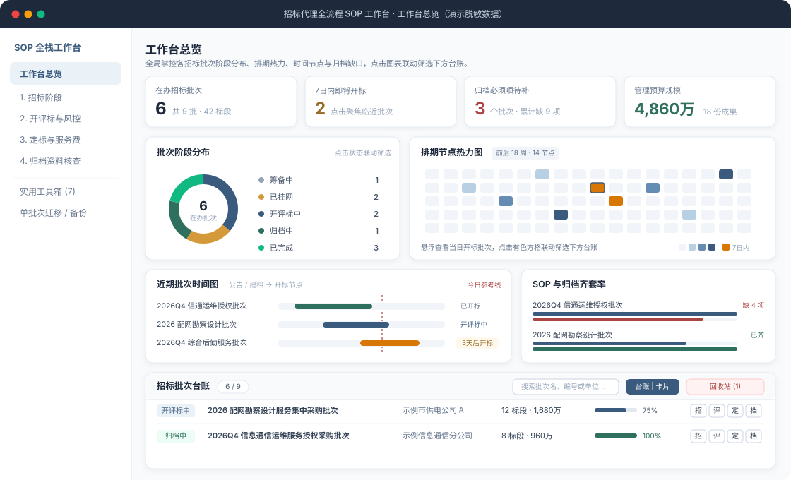
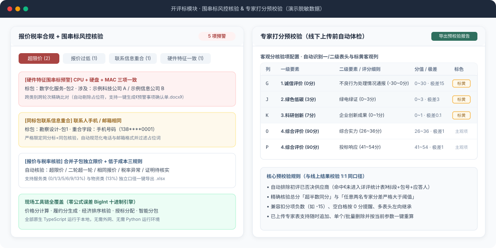
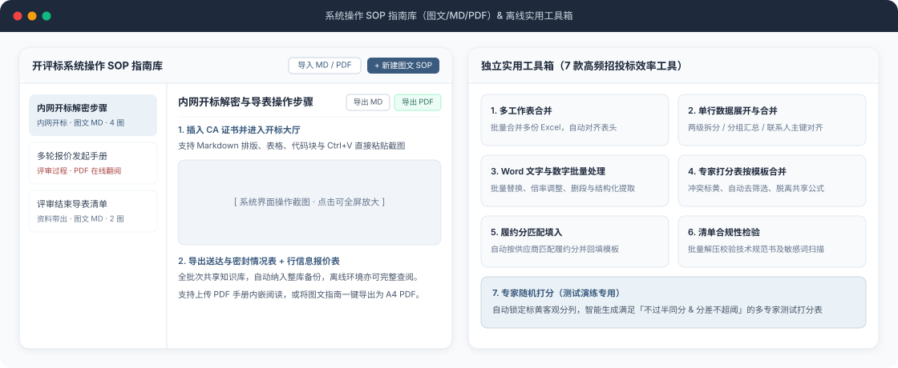
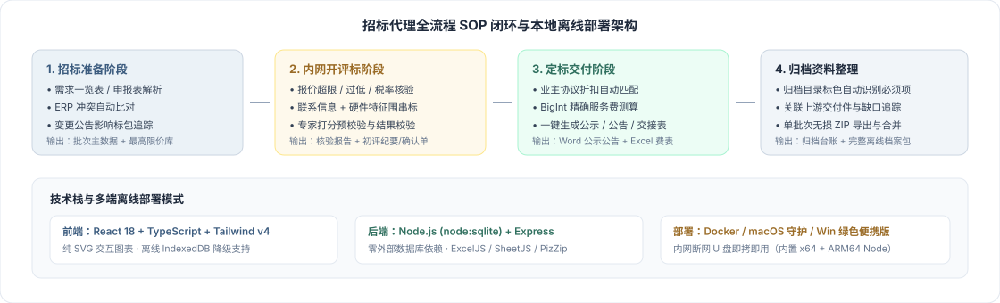

# 招标代理全流程 SOP 工作台（Tender SOP Workstation）

面向电力与能源行业招标代理业务的一体化离线全栈工作台，覆盖 **招标准备 → 内网开评标与风控核验 → 定标服务费测算与文书生成 → 归档齐套管理** 全生命周期 SOP。

- **技术栈**：React 18 · TypeScript 5.7 · Tailwind CSS v4 · Node.js 22+ (`node:sqlite`) · Express 4
- **离线部署**：支持 macOS 常驻服务、Docker 容器与 Windows 绿色便携版（内置 x64 + ARM64 Node.js）

## 项目简介

招标代理项目在 **外网挂网 — 内网断网开评标 — 外网定标归档** 的实际流转中，常面临表格来源分散、人工核验易漏、离线工具割裂、服务费与文书反复手工套用等问题。

本工作台以 **零外部数据库依赖、完全支持内网断网运行** 为设计原则：
- **一套主数据贯通全流程**：上传需求一览表、开标一览表、行信息报价表、否决统计表与总分排序表后，自动完成限价核验、围串标风控、服务费测算、Word/Excel 交付物生成与归档齐套检查。
- **高精度算分与费率引擎**：基于 `BigInt` 定点十进制运算，消除浮点舍入误差，与原 Excel 公式及四舍五入口径保持严格一致。
- **内外网无缝协同**：内置单批次无损 ZIP 导出与合并导入，以及整库备份恢复能力，方便在办公机与内网开评标终端之间安全流转数据。

## 界面预览（脱敏演示数据）

### 1. 工作台总览（交互式看板 + 收纳式批次台账 + 回收站）
顶部 4 项动态 KPI 卡、批次阶段分布环形图、18 周排期节点热力图、近期项目时间图、SOP 与归档齐套率对比图均支持点击联动筛选下方台账；支持两步软删除回收站与“先备份再删”高危确认弹窗。



### 2. 开评标风控核验 & 专家打分预校验
自动完成超限价（含合并子包各轮次）、低于成本三规则、二轮超一轮、税率异常/证明待核实、同标包联系信息重合与硬件特征（CPU/硬盘/MAC）围串标预警；专家打分预校验自动识别一/二级表头、最高/最低/极差行及标黄客观分列。



### 3. 系统操作 SOP 指南库 & 独立实用工具箱
全批次共享的系统操作指南库支持图文 Markdown、剪贴板粘贴截图、直接导入 `.md` / `.pdf` 在线阅读及一键导出 MD / A4 PDF；内置 7 款高频离线招投标小工具。



## 全流程架构



## 核心功能模块

| 模块 | 核心能力 |
| :--- | :--- |
| **工作台总览** | 动态 KPI 指标卡、阶段分布环形图、18 周排期热力图、里程碑时间轴、SOP/归档齐套率对比、紧凑台账/卡片视图切换、批次回收站与带备份确认的永久删除 |
| **1. 招标准备** | 5 槽位前期表格自动解析（需求一览表、申报表、ERP 导表、供应商联系人信息表等）、ERP 差异冲突检测、变更公告管理与受影响标包高亮追踪 |
| **2. 开评标与风控** | 报价与税率核验（超限价/报价过低/二轮超一轮/相同报价/税率合规）、围串标风控（联系信息重合/硬件特征一致）、7 款现场核验算分工具（含专家打分预校验与结果校验）、预警确认单/初评汇报/会议纪要生成、图文/MD/PDF 系统操作指南库 |
| **3. 定标交付** | 业主单位协议折扣自动匹配（支持导入客户协议清单 Excel）、BigInt 精确阶梯服务费与平台费测算、Word 公示/公告（可选列自定义）与 Excel 交接单/费表一键生成 |
| **4. 归档核查** | 自动识别归档清单 Excel 标色必须项、关联上游已上传/已生成文件、实时统计必须项缺口与齐套率 |
| **实用工具箱（7 款）** | 多工作表合并、单行数据展开与合并（两级拆分/分组汇总）、Word 文字与数字批量处理、专家打分表按模板合并、履约分匹配填入、清单合规性检验、专家随机打分（测试演练） |
| **备份与迁移** | 整库 ZIP 备份与原地无损恢复；单批次无损 ZIP 导出与跨端合并导入 |

## 快速开始

### 环境要求
- **Node.js >= 22.5.0**（使用 Node 原生 `node:sqlite` 模块）

### 1. 安装依赖并启动开发环境
```bash
git clone <your-repo-url>
cd tender_workstation_gemini

# 安装根目录、前端与后端依赖
npm run install:all

# 复制环境变量模板（按需修改）
cp .env.example .env

# 同时启动后端 API (3001) 与前端开发服务器
npm run dev
```
首次启动会在本地自动初始化 SQLite 数据库并写入 3 组脱敏演示批次数据，可直接体验全部界面与功能。

### 2. 生产构建与运行
```bash
npm run build
npm start
```
默认访问地址：`http://localhost:3001`

### 3. Docker 一键部署
```bash
cp .env.example .env
# 公网部署请务必在 .env 中设置 AUTH_ENABLED=true 并修改 AUTH_PASSWORD / AUTH_SECRET
docker compose up -d --build
```

### 4. 构建 Windows 内网绿色便携版（免安装）
```bash
npm run build
npm run build:win-portable
```
输出目录位于 `release/tender-workstation-win-portable/`，内置 Windows x64 + ARM64 Node.js 运行时，拷贝至内网 Windows 电脑后双击启动脚本即可离线运行。

## 目录结构

```text
tender_workstation_gemini/
├── client/                  # React + TypeScript + Tailwind v4 前端
│   └── src/
│       ├── api/             # API 客户端与 IndexedDB 降级层
│       ├── components/      # 图表看板、打分预校验、SOP 指南库、工具箱面板等
│       ├── pages/           # 总览 / 招标 / 开评标 / 定标 / 归档 / 工具箱页面
│       └── utils/           # 表格展开合并、标包排序、术语切换等工具
├── server/                  # Node.js + Express + SQLite 后端
│   └── src/
│       ├── routes/          # 各业务模块 REST 路由
│       ├── db.ts            # SQLite 表结构与增量迁移
│       ├── seed.ts          # 脱敏演示数据初始化
│       └── *Audit/Parser.ts # 报价/税率/围串标/打分校验/服务费/模板合并核心引擎
├── scripts/                 # macOS 部署脚本与 Windows 绿色便携打包脚本
├── docs/screenshots/        # README 脱敏界面预览图 (SVG)
├── .env.example             # 环境变量模板（含访问密码与可选机构占位配置）
├── Dockerfile
└── docker-compose.yml
```

## 数据安全与隐私说明

- **本地数据完全隔离**：所有真实业务数据库（`data/`、`*.db`）、上传附件（`uploads/`）、环境变量（`.env`）及本地校验文件（`工具校验/`、`sample_docs/`）均已在 `.gitignore` 中严格屏蔽，不会进入 Git 仓库。
- **默认内置脱敏演示数据**：代码库中的初始批次、客户协议费率及预览截图均为虚构演示数据；真实客户协议清单与物料编码库可在「定标模块」中通过本地 Excel 一键导入覆盖。
- **可选访问保护**：如需部署到局域网或公网，请在 `.env` 中开启 `AUTH_ENABLED=true` 并配置强密码 `AUTH_PASSWORD` 与随机签名密钥 `AUTH_SECRET`；开启后，回收站内的「永久彻底删除批次」操作也将强制执行后端密码二次校验。
